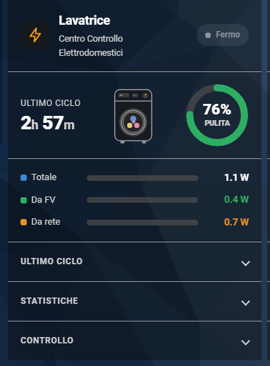

# Centro Controllo Elettrodomestici (Card)

[](https://github.com/SalvatoreITA/Centro-Controllo-Elettrodomestici-Card/blob/main/README_it.md)
[](https://github.com/SalvatoreITA/Centro-Controllo-Elettrodomestici-Card/blob/main/README.md)

[](https://github.com/hacs/integration)
[]()
[](https://www.domhouse.it)

Card Lovelace per **Home Assistant** che mostra, in un'unica scheda, tutto ciò che il custom component:
[**Centro Controllo Elettodomestici**](https://github.com/SalvatoreITA/Centro-Controllo-Elettrodomestici) genera per un elettrodomestico: stato, durata e consumi del ciclo, split per fonte (fotovoltaico / batteria / rete), energia pulita, statistiche e controlli.

La card **si disegna da sola** a partire dallo *slug* del device: niente dipendenze (no card-mod, no button-card), niente lista di entità da scrivere a mano.

La card è adattiva: si riconfigura da sola in base al tuo impianto. Con il fotovoltaico (e l’eventuale batteria) mostra la ripartizione delle fonti e l’energia pulita; senza, si semplifica e mette in evidenza la potenza istantanea. Così va bene per tutti, con o senza impianto.

<div align="center">
  
</div>

## 🌟 Caratteristiche

- **Auto-generante**: basta lo slug del device, la card ricava da sola tutte le entità.
- **Adattiva alle fonti**: mostra "Da FV" e "Da batteria" solo se le hai; chi non ha il fotovoltaico vede un layout dedicato con la **potenza istantanea**.
- **Hero dinamico**: durata del ciclo (in corso / ultimo), illustrazione animata dell'elettrodomestico, cerchio con % di energia pulita o potenza.
- **Barre di ripartizione** colorate e proporzionali (Totale / Da FV / Da batteria / Da rete).
- **Statistiche** oggi / mese / anno, ultimo ciclo, storico 7 giorni.
- **Sezione Controllo** integrata: presa, canali notifiche, fascia oraria, spegnimento automatico, reset contatori.
- **~30 illustrazioni** di elettrodomestici, animate quando l'apparecchio è in funzione.
- Tema chiaro/scuro, nessuna dipendenza esterna.

## ⚠️ Prerequisiti
Per far funzionare questa card, **DEVI** prima installare il componente base che calcola i dati.
👉 **[Scarica l'integrazione backend da qui](https://github.com/SalvatoreITA/Centro-Controllo-Elettrodomestici/)**.

## 📥 Installazione tramite HACS (Consigliata)

1. Apri **HACS** nel tuo Home Assistant.
2. Clicca sui tre puntini in alto a destra e seleziona **Custom repositories** (Repository personalizzati).
3. Incolla l'URL di questo repository GitHub: https://github.com/SalvatoreITA/Centro-Controllo-Elettrodomestici-Card
4. Come categoria (Category) scegli **Lovelace**.
5. Clicca su **Add** (Aggiungi).
6. Ora cerca ""DomHouse Centro Controllo Elettrodomestici Card" in HACS, clicca su **Download** e poi ricarica la pagina del tuo browser.

### Installazione Manuale (Senza HACS)
1. Scarica il file `domhouse-octopus-bundle.js`.
2. Copialo nella tua cartella `www` di Home Assistant (/config/www/).
3. Vai su **Impostazioni > Dashboard > Risorse**.
4. Aggiungi una nuova risorsa: `/local/domhouse-elettrodomestici-card.js` impostando il tipo su **Modulo JavaScript**.
5. Ricarica la pagina.

> Dopo ogni aggiornamento del file, ricarica con **Ctrl+Shift+R** per bypassare la cache del browser.

## ⚙️ Configurazione

Esempio minimo:

```yaml
type: custom:domhouse-elettrodomestico-card
appliance: lavatrice
```

Esempio completo:

```yaml
type: custom:domhouse-elettrodomestico-card
appliance: lavatrice      # slug del device (OBBLIGATORIO)
name: Lavatrice           # opzionale: titolo mostrato in alto
icona: lavatrice          # opzionale: illustrazione (default: presa)
potenza_max: 2500         # opzionale: fondo scala W per barre e cerchio (default 3000)
```

| Opzione | Obbligatoria | Default | Descrizione |
|---------|:---:|---------|-------------|
| `appliance` | ✅ | — | Lo **slug** del device DomHouse (es. `lavatrice`). È il nome del device reso minuscolo con gli spazi in `_`. |
| `name` | — | dallo slug | Titolo mostrato in testata. |
| `icona` | — | `presa` | Illustrazione (vedi [elenco](#illustrazioni)). |
| `potenza_max` | — | `3000` | Fondo scala in W: regola il riempimento delle **barre** e del **cerchio potenza** (utile per tarare su phon, PC, forno, ecc.). |

Per più elettrodomestici: una card ciascuno, cambiando `appliance` e `icona`.

---

## 🎨 Editor grafico

La card ha un editor visuale (Modifica scheda → la trovi nell'elenco card, oppure ⚙️). Puoi impostare:
- **Elettrodomestico (slug del device)**
- **Nome**
- **Illustrazione** (menu a tendina)
- **Fondo scala potenza · W (barre e cerchio, default 3000)**

In fondo all'editor trovi il credito *Salvatore Lentini · DomHouse.it · v3.0*.

---

## 🖱️ Comportamento adattivo

La card controlla **quali entità esistono** e cambia layout di conseguenza.

### Con fotovoltaico e/o batteria
- **Cerchio** in alto a destra: **% di energia pulita** del ciclo (FV + batteria), in verde.
- **Barre**: Totale, Da FV, Da batteria (se presente), Da rete — ciascuna colorata e proporzionale alla potenza sul **fondo scala** (`potenza_max`). La somma delle fonti corrisponde al Totale.
- Le voci che non ti riguardano spariscono (niente "Da batteria" se non hai l'accumulo).

### Senza fotovoltaico né batteria
- Le barre vengono **nascoste** (non servono: è tutto da rete).
- Il cerchio diventa la **potenza istantanea in W**, colore **rosso**, e si riempie in proporzione al consumo sul fondo scala (`potenza_max`, default 3000 W → a 1500 W il cerchio è a metà).
- La sezione *Ciclo in corso* mostra solo **Energia** e **Costo**, centrati.

| | Con FV/batteria | Senza FV/batteria |
|---|---|---|
| Cerchio | % pulita (verde) | Potenza W (rosso) |
| Barre | Totale/FV/batteria/rete | nascoste |
| Tile ciclo | Energia, FV, (batteria), rete, Costo | Energia, Costo |

---

## 📦 Illustrazioni

Valori ammessi per `icona` (si animano quando l'elettrodomestico è **in funzione**):

`lavatrice`, `asciugatrice`, `lavasciuga`, `lavastoviglie`, `forno`, `microonde`, `friggitrice_aria`, `frigo`, `congelatore`, `piano_cottura`, `scaldabagno`, `phon`, `macchina_caffe`, `bimby`, `deumidificatore`, `climatizzatore`, `pc`, `presa`, `ferro`, `ventilatore`, `stufetta`, `tv`, `console`, `wallbox`, `pompa_calore`, `aspirapolvere`, `pompa_acqua`, `bollitore`, `tostapane`, `stampante_3d`.

Se `icona` non è valida, viene usata `presa`.

---

## 🔌 Sezioni della card

Dall'alto in basso:

1. **Testata** — nome, sottotitolo, stato (*In funzione* / *Fermo*).
2. **Hero** — durata del ciclo (in corso o ultimo), illustrazione animata, cerchio (pulita o potenza).
3. **Barre** — ripartizione della potenza per fonte (solo con FV/batteria).
4. **Ciclo in corso / Ultimo ciclo** *(a scomparsa)* — Energia, Da FV, Da batteria, Da rete, Costo.
5. **Statistiche** *(a scomparsa)* — tab Oggi / Mese / Anno (Energia, Costo, Cicli, Tempo), ultimo ciclo (Fine/Durata/Costo), tabella ultimi 7 giorni.
6. **Controllo** *(a scomparsa)* — vedi sotto.

> Le tre sezioni a tendina (**Ciclo in corso**, **Statistiche**, **Controllo**) partono **sempre chiuse** a ogni apertura della card. Le apri con un tocco; rientrando tornano chiuse.

### Sezione Controllo
- **Presa**: accendi/spegni la presa smart (se configurata).
- **Spegnimento automatico**: abilita lo spegnimento a orario e imposta l'ora.
- **Notifiche**: interruttori **Push / Google / Alexa / HA** e **fascia oraria** (Google/Alexa) per le notifiche di fine ciclo gestite dal blueprint.
- **Contatori**: pulsante **reset** (con conferma), chiama `domhouse_elettrodomestici.reset`.

---

## ⚖️ Entità usate

La card costruisce gli `entity_id` come `<dominio>.<slug>_<suffisso>` a partire da `appliance`. Esempi con `appliance: lavatrice`:
`binary_sensor.lavatrice_in_funzione`, `sensor.lavatrice_potenza`, `sensor.lavatrice_potenza_da_fotovoltaico`, `sensor.lavatrice_potenza_da_batteria`, `sensor.lavatrice_potenza_da_rete`, `sensor.lavatrice_energia_pulita_ciclo`, `sensor.lavatrice_energia_ciclo`, `sensor.lavatrice_durata_ciclo`, `sensor.lavatrice_costo_ciclo`, le statistiche `..._energia_oggi/mese/anno`, `switch.lavatrice_presa`, `time.lavatrice_spegnimento_automatico`, ecc.

Se un'entità **non esiste** (es. non hai la batteria), la relativa riga/tile semplicemente non viene mostrata.

## ☕ Supporta il Progetto

Ogni piccolo supporto fa un'enorme differenza: mi aiuta a mantenere vivo l'entusiasmo e mi stimola a creare e condividere nuove soluzioni per la community. Grazie di cuore per il tuo aiuto! 🚀

[](https://ko-fi.com/salvatore_dh)

## ❤️ Crediti
Sviluppato da [Salvatore Lentini - DomHouse.it](https://www.domhouse.it)
